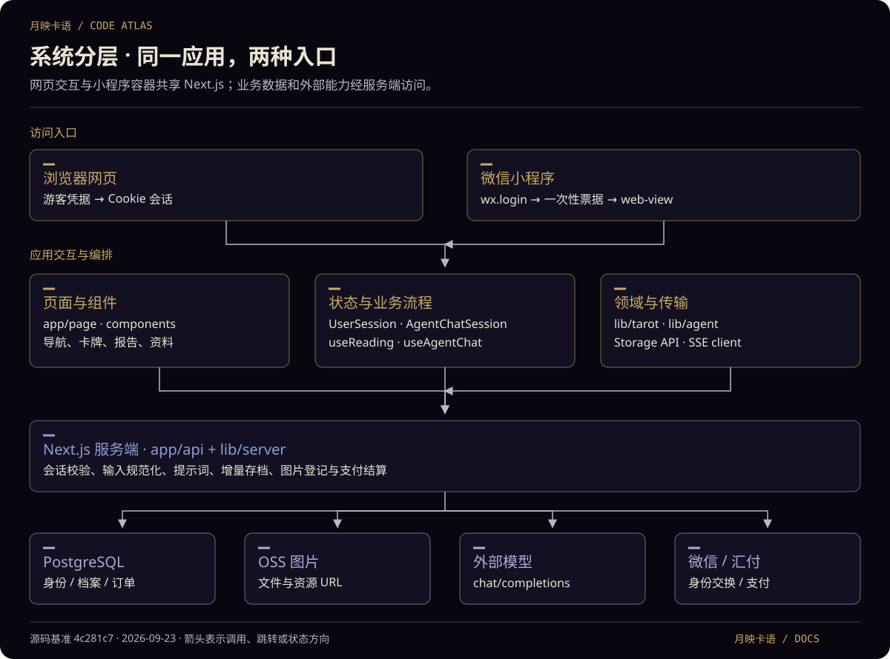
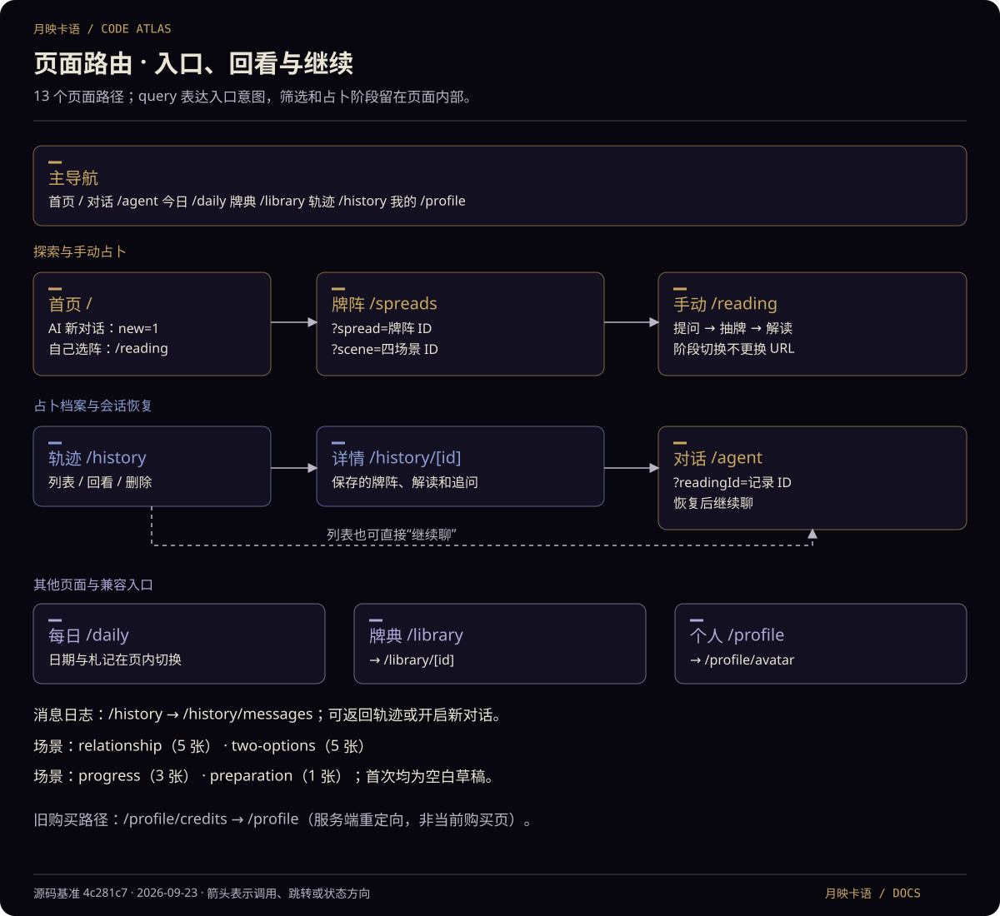
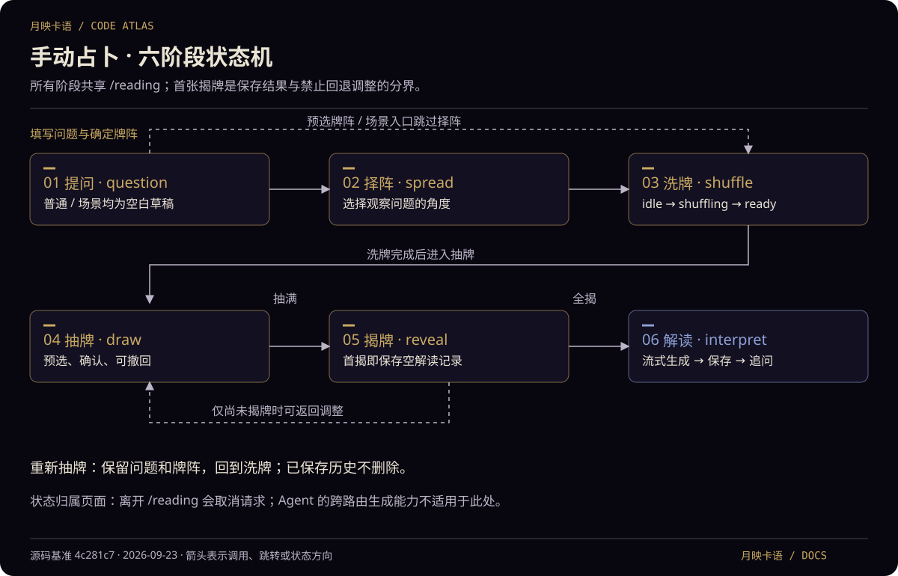
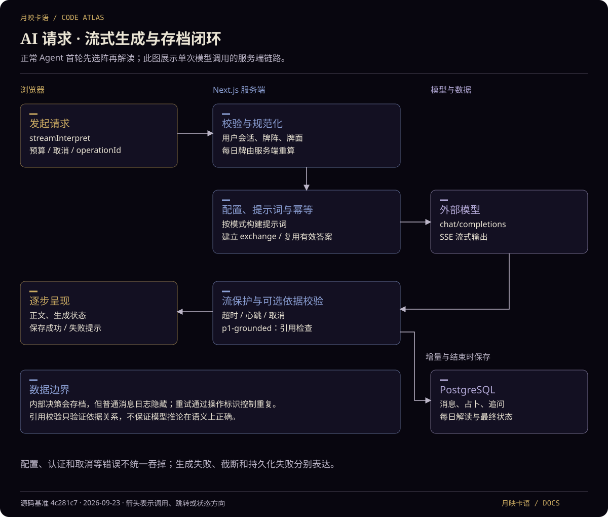

# 月映卡语 · 代码结构与业务架构

> 源码核对日期：2026-09-23 · 远端基准提交：`4c281c7` · 分支：`codex/integration-20260922`
> 范围：代码结构、业务流程、前端路由、后端接口及数据边界。本文描述同步远端后、包含保留的本地品牌和文档改动的工作区实现，不代表线上部署或真实业务验收结果。

月映卡语是一个 Next.js 全栈塔罗应用。浏览器负责交互、抽牌和对话编排；同一 Next.js 服务负责认证、模型调用、持久化、图片和支付。微信小程序负责原生登录与 web-view 承载，复用这套网页。

当前有 **13 个页面路由、20 个 API 路径、31 个 HTTP 方法处理器、19 份 SQL 迁移文件**。参数入口不重复计为页面；动态路由按路径模式计数。

## 阅读导航

- [整体架构](#整体架构)
- [代码目录与职责](#代码目录与职责)
- [前端页面与跳转](#前端页面与跳转)
- [业务流程](#业务流程)
- [后端接口清单](#后端接口清单)
- [品牌配置与同步边界](#品牌配置与同步边界)
- [数据与持久化](#数据与持久化)
- [启动测试与部署](#启动测试与部署)
- [实现边界与阅读顺序](#实现边界与阅读顺序)

## 整体架构



图表沿用 [globals.css](../app/_styles/globals.css) 的深墨、象牙、柔金、星辰蓝和月雾紫。金色标记交互与业务步骤，蓝色标记服务端边界，紫色标记存储及外部依赖；标题同时表达含义，不只依赖颜色。SVG 可独立放大，正文表格提供完整可搜索说明。

| 层次 | 实现 | 架构作用 |
| --- | --- | --- |
| 运行时 | Node.js 24.x | `.nvmrc` 与 Linux 构建镜像指定 |
| 应用框架 | Next.js 16.1.6 App Router | 页面渲染、文件路由、Route Handlers |
| 前端 | React 19.2.3、TypeScript、Tailwind CSS 4、CSS Modules | UI、交互与样式 |
| 状态管理 | Hooks、Context、局部 reducer | 用户、Agent 会话和手动抽牌状态 |
| 数据库 | PostgreSQL + `pg` + 原生 SQL | 用户隔离、JSONB、事务和触发器 |
| 图片 | 阿里云 OSS + 数据库资源登记 | 图片字节与 URL 分离管理 |
| AI | OpenAI-compatible `chat/completions` + SSE | 决策、解读、追问和流式响应 |
| 支付 | 汇付接口、通知验签、定时查单 | 订单状态与积分入账 |
| 测试 | Vitest、Testing Library、jsdom | 领域、组件、接口与可选数据库集成测试 |

这是单仓库全栈应用，不是独立前后端服务，也没有独立 AI Agent 工作进程。支付查单在 Node 应用进程内运行，不属于外部任务队列。

## 代码目录与职责

```text
tarot-web/
├── app/                     页面和 API 文件路由
│   ├── layout.tsx           根布局、字体、背景、错误边界和用户会话
│   ├── page.tsx             首页路由入口
│   ├── _components/home/   首页专用组件
│   ├── _styles/             全局样式、共享小操作样式及 home/ 首页样式
│   ├── agent/              AI 对话
│   ├── reading/            手动占卜
│   ├── spreads/            牌阵与场景入口
│   ├── daily/              每日牌与札记
│   ├── library/            牌典及牌义详情
│   ├── history/            历史记录与消息日志
│   ├── profile/            个人资料与头像
│   └── api/                 后端 HTTP 接口
├── components/              展示组件、抽牌交互、报告和会话 Provider
│   ├── cards/               卡牌、牌背、扇形布局、牌义与几何计算
│   ├── drawing/             选阵、洗牌、抽牌、揭牌及仪式交互
│   ├── reading/             解读报告、追问与报告输入框
│   ├── question/            初始提问、开头建议与提问页骨架
│   ├── history/             历史列表、历史报告与页面框架
│   ├── profile/             个人资料、头像与资料页骨架
│   ├── session/             用户与 Agent 会话 Provider
│   ├── layout/              主导航、移动布局、转场及返回链接样式
│   ├── effects/             背景氛围、狐狸与眼睛动画
│   ├── common/              确认框、错误边界、设置及通用骨架
│   └── daily/               每日牌预览
├── hooks/                   页面状态与异步业务流程协调
├── lib/
│   ├── tarot/               卡牌、牌阵、抽牌、每日牌和领域类型
│   ├── agent/               自动选阵、抽牌、解读和追问编排
│   ├── intent/              意图协议、原文依据校验、澄清与回答策略
│   ├── api/                 流式通信、提示词、生成状态和服务端配置
│   ├── auth/                前端身份辅助、游客凭据和微信恢复
│   ├── server/              认证、数据库、存档、图片和支付逻辑
│   ├── payments/            H5 收银台链接处理
│   ├── brand.ts             网页品牌配置入口，复用小程序公开配置
│   ├── questionInput.ts     首次提问字数统计与阈值
│   ├── readingEntry.ts      四场景定义及 URL 入口校验
│   └── *Storage.ts          前端持久化 API 封装
├── database/                PostgreSQL 迁移 SQL
├── miniprogram/             原生登录与 web-view 壳页；brand.js 是公开品牌源
├── scripts/                 启动、迁移、图片同步、评估和打包
├── tests/                   测试、fixtures 和浏览器验证脚本
├── public/                  卡牌、品牌、字体等资源
├── docs/                    使用、配置、架构、评阅和交付记录
├── model.config.json        私有配置，Git 忽略，不应传播内容
├── next.config.ts           standalone、图片重写和文件追踪
└── Dockerfile.build         Linux 构建与发布包导出
```

`app/` 按现有路由目录组织页面，不使用括号分组。`_components`、`_styles` 是不参与路由的私有目录，按用途收纳首页组件和样式。所有页面继续共用根布局，没有新增布局、重定向或权限限制；页面及 `api/` 的公开路径保持不变。

| 核心模块 | 职责 | 主要协作对象 |
| --- | --- | --- |
| [UserSession](../components/session/UserSession.tsx) | 用户资料、登录恢复、收藏、每日草稿 | 用户 API、游客登录、微信恢复 |
| [AgentChatSession](../components/session/AgentChatSession.tsx) | 路由页面之上的聊天与草稿 | `useAgentChat` |
| [useAgentChat](../hooks/useAgentChat.ts) | 消息、取消、重试、恢复、会话同步 | `agentTurn`、存储 API |
| [agentTurn](../lib/agent/agentTurn.ts) | 自动选阵、首轮、追问、重生成编排 | 抽牌、提示词、流式客户端 |
| [useReading](../hooks/useReading.ts) | 手动占卜与追问协调 | `useManualDraw`、流式客户端、存储 |
| [manual-draw](../lib/tarot/manual-draw.ts) | 抽牌状态和转换守卫 | `useManualDraw`、牌堆组件 |
| [stream-client](../lib/api/stream-client.ts) | SSE、预算、重试、取消 | 流式配置 API、解读 API |
| [interpret route](../app/api/interpret/route.ts) | 输入规范化、提示词、上游调用、流保护 | 配置、聊天存档、依据引用校验 |
| [chat](../lib/server/chat.ts) | 操作幂等、增量保存、关联档案更新 | PostgreSQL 事务 |
| [database](../lib/server/database.ts) | 连接池与事务 | `pg`、私有运行配置 |

`lib/api/` 同时包含浏览器与服务端模块，运行位置应沿 import 判断。`readingStorage.ts` 等通过 HTTP API 保存到 PostgreSQL，不能按文件名理解为 localStorage。

## 前端页面与跳转



图中展示主要任务路径，完整页面如下。主导航由页面或页面容器引入，根布局不会自动为每一页挂载导航。`MainNav` 将 `/reading` 的选中项映射为“对话”，但点击该项仍跳到 `/agent`；这是导航高亮映射，不是页面重定向。

| 页面路由 | 职责 | 主要后续跳转 |
| --- | --- | --- |
| `/` | 首页、场景、每日预览 | 新对话、手动占卜、牌阵、牌典 |
| `/agent` | AI 选阵、自动抽牌、解读和追问 | 首页、历史；新问题在会话内处理 |
| `/reading` | 手动占卜六阶段 | 首页、历史；新问题在本页重置 |
| `/spreads` | 通用牌阵和场景选择 | `/reading?spread=...`、`/reading?scene=...` |
| `/daily` | 每日牌、指引和札记 | 日期切换在页面内，不更换 URL |
| `/library` | 牌典、分类和收藏筛选 | `/library/[id]`；筛选不更换 URL |
| `/library/[id]` | 单张牌义，预生成 78 张牌的路径 | 返回牌典；未知 ID 返回 404 |
| `/history` | 占卜档案、选择删除 | 历史详情、Agent 恢复、消息日志 |
| `/history/[id]` | 回看和删除保存的牌阵、正文、追问 | 继续聊进入 Agent；删除后回历史 |
| `/history/messages` | 消息日志、分页、清空 | 历史、新对话 |
| `/profile` | 资料、统计和个人入口 | 头像、历史、消息、每日、牌典 |
| `/profile/avatar` | 编辑头像 | 保存或取消回个人中心 |
| `/profile/credits` | 兼容已撤下的购买路径 | 服务端直接重定向 `/profile` |

### 查询参数与入口行为

| 入口 | 行为 |
| --- | --- |
| `/agent` | 进入已有聊天会话；主导航和首页探索卡使用 |
| `/agent?new=1` | 新对话意图；有活动生成或草稿先确认，处理后 `replace('/agent')` |
| `/agent?readingId=<id>` | 恢复占卜及追问；已有活动内存状态优先，避免数据库快照覆盖 |
| `/reading?spread=<id>` | 预选牌阵，填问题后跳过择阵 |
| `/reading?scene=relationship` | 关系走向：关系牌阵，5 张；专属 placeholder 与开头建议 |
| `/reading?scene=two-options` | 二选一：二择一牌阵，5 张；专属 placeholder 与开头建议 |
| `/reading?scene=progress` | 事情进展：三张牌阵，3 张；专属 placeholder 与开头建议 |
| `/reading?scene=preparation` | 临场准备：单张牌，1 张；专属 placeholder 与开头建议 |
| `/reading?scene=stuck` | 反复卡住：时间之流，5 张；梳理反复困扰与调整方向 |

[readingEntry.ts](../lib/readingEntry.ts) 统一解析入口。未知或重复的 `scene` / `spread` 值、`scene` 与 `spread` 同时出现，会降级普通入口并提示；URL 不接收任意问题草稿。通用选择器展示单张、三张、时间之流、凯尔特十字四种牌阵，四类场景通过单独入口展示，复用既有牌阵；底层牌阵库仍为六种。首页及牌阵页的牌数由实际 `spread.positions.length` 计算，不固定显示 5 张。

历史“继续聊”统一进入 Agent，即使来自手动占卜，也不会回到抽牌状态机。来源：[HistoryReadingReport](../components/history/HistoryReadingReport.tsx)、[agent/page](<../app/agent/page.tsx>)。

### 场景提问与输入规则

- 四场景初次进入时草稿都是空字符串。引导放在 placeholder 和“不知道怎么开头”的三个场景专属建议中，只有用户点击建议才填入草稿，不自动塞入模板正文。
- `/agent` 与普通 `/reading` 保留通用引导；专属建议仅随场景传给 `QuestionWelcome`。
- 场景内“新问题”会清空草稿、保留场景和预选牌阵；重新抽牌仍保留原问题。外部切换入口会重置对应流程；主动更换牌阵则切回普通入口并保留已有草稿。
- [questionInput.ts](../lib/questionInput.ts) 定义首次提问最多 **500 字**，超过 **400 字**时计数提示。按 Unicode 字素计数，旧 WebView 回退码点计数，CRLF 统一为换行。
- 超过 500 字会禁用提交并显示提示，同时拦截已有的提交快捷键；粘贴、建议和编辑产生的原文不会被截断。输入框从四行高度自动伸缩，宽度与字体加载变化后重新测量。
- 该限制作用于共享提问入口的前端 UX，不是后端所有问题、历史或追问的统一上限；API 原有校验未随此轮改动。

### 布局和会话生命周期

```text
RootLayout
  ├── 字体、全局 CSS、AmbientField
  └── ErrorBoundary
       └── UserSession / UserContext
            └── AgentChatSession / AgentChatContext
                 └── 当前路由 page
```

- `UserSession` 在 pathname 改变时检查 `/api/auth/me`。401 后普通网页自动游客登录，小程序尝试微信恢复；服务异常不会直接切换身份。
- `/agent`、`/reading`、`/daily`、`/history` 及子路径在会话未就绪时显示骨架或登录状态，没有独立 `/login` 路由。UI 控制不替代 API 权限校验。
- Agent 的生成与草稿属于根部 Provider，网页内部路由切换不终止生成；刷新、关闭网页不等同于路由切换，活动请求与内存草稿不保证恢复。
- 手动 `useReading` 属于页面，卸载会中止请求，不能套用 Agent 的跨页面行为。

## 业务流程

### 登录：网页游客与微信账号

普通网页由 [guest.ts](../lib/auth/guest.ts) 生成随机凭据并优先保存在 localStorage；不可用时仅保留页面内存凭据。`POST /api/auth/guest` 使用散列恢复或创建用户，建立 Cookie 会话。历史仍在数据库；游客凭据丢失后不能假定原身份自动可找回。

小程序只有 `pages/index/index` 壳页：[index.js](../miniprogram/pages/index/index.js) 调 `wx.login`，把 code 交给 `/api/auth/wechat`；web-view 打开 `/api/auth/wechat/consume?ticket=...&next=...`，服务端设置 Cookie 后跳到目标网页。

小程序使用独立登录尝试标识和卸载清理，防止旧回调覆盖新状态。基础库 `__subPageFrameEndTime__` 异常的历史调查不能作为彻底解决的证据，见[排查记录](./tasks/wechat-frame-recovery-20260911.md)。

### 手动占卜：一个 URL 内的六阶段



[manual-draw.ts](../lib/tarot/manual-draw.ts) 定义 `question → spread → shuffle → draw → reveal → interpret`。六阶段都在 `/reading`，不是六个页面。

1. 提问后选择牌阵；预选牌阵和场景跳过择阵。
2. 洗牌形成牌堆和正逆位；round 标识防止旧动画回调污染新一轮。
3. 预览、确认卡牌到牌位；抽满后进入全盖着的揭牌状态。
4. 尚未揭牌可返回调整；首次揭牌时保存牌面和空解读，锁定结果。
5. 全揭后请求解读，先保证牌面记录存在，再更新正文和生成状态。
6. 追问先判断直接回答或补牌；需要补牌时，揭牌后再生成回答。

重新抽牌保留问题与牌阵，回到洗牌；修改问题或牌阵重置牌堆，已保存历史不删除。实现：[useReading](../hooks/useReading.ts)、[useManualDraw](../hooks/useManualDraw.ts)。

**抽牌交互约束：** 单指拨牌预选、再次轻点或向外拖出确认；双指缩放和平移，双指接管取消单指抽取。点击、拖出、键盘共用确认路径，动画期间防重复提交。页面隐藏、失焦、尺寸变化和卸载会清理交互；减少动态效果时使用简化反馈。手势、动画和真机边界见 [MINIAPP.md](./MINIAPP.md)、[交付记录](./tasks/fan-stage-20260911.md)、[design-qa.md](./design-qa.md)。

### Agent：自动选阵、解读和追问

[agentTurn.ts](../lib/agent/agentTurn.ts) 编排 `模型选阵 → 浏览器抽牌 → 模型解读`，正常首轮通常两次模型调用。选阵无法解析或明确的暂时错误可回退默认牌阵；认证、配置、取消错误不能概括为都会回退。

追问为 `模型决定直接回答 / 补牌 → 可选补牌 → 回答`。重生成解读复用既定牌阵和牌面，重新抽牌是另一项操作。`useAgentChat` 管理消息、取消、重试与恢复，`AgentChatSession` 使路由切换只卸载视图。

### 模型请求：统一入口与服务端保存



1. `streamInterpret` 读取公开流式配置，建立总预算、取消信号和操作标识。
2. `/api/interpret` 验证用户与请求。普通解读按服务端牌库和牌阵规范化输入；每日解读按日期重新算牌，覆盖客户端牌义。
3. 服务端读取模型配置，忽略客户端 endpoint/key/model 覆盖值，按类型构建提示词。
4. `startChatExchange` 记录输入与回复上下文。同用户同 operationId 用事务锁串行处理；内容不匹配或仍在运行返回冲突，已有有效答案可回放。
5. 请求外部 `chat/completions`，通过 SSE 返回，处理连接、有效输出、总时长、心跳和取消。
6. 服务端增量保存消息并更新关联占卜、追问或每日解读，结束时记录最终状态。SSE 另报告 `persistence: saved / failed`。

提示词配置支持 `p0`、`p1`、`p1-grounded`，未配置 profile 时保持 `p0` 行为。启用 `p1-grounded` 时结构化正文检查牌面依据引用；Agent 决策和追问 decide 不走此分支。**引用检查不等于验证推论在语义上正确。** 参见 [server-config](../lib/api/server-config.ts)、[grounded-reading-stream](../lib/api/grounded-reading-stream.ts)。

### 每日牌、牌典和个人资料

- **每日牌：** [daily.ts](../lib/tarot/daily.ts) 以本地日期为输入，同日期所有用户得到同牌与正逆位。访问、札记和 AI 解读按用户保存，旧札记需明确导入，不覆盖已在线编辑内容。
- **牌典：** 静态数据有 78 张牌，详情路由预生成；收藏经 API 写库，收藏 ID 随 `/api/auth/me` 返回。
- **个人资料：** 昵称和头像通过用户 API 修改；头像归一化后上传 OSS。累计占卜次数与历史条数不同，删除记录不回减累计次数。

### 支付与积分：后端保留，购买页已撤下

套餐来自 `tarot_plans`，客户端只提交 `planId`；服务端创建或复用订单，返回收银台 URL。通知与主动查单共用结算，核对订单后幂等写流水，数据库触发器增加余额。

- `/profile/credits` 重定向个人中心，不能描述为仍可用的购买页。
- 游客不能创建支付订单；微信用户仍有后端下单能力。
- **没有解读或抽牌扣减积分、余额不足拦截逻辑**，充值和余额不代表已形成消费闭环。
- [payment-poller](../lib/server/payment-poller.ts) 由 [instrumentation](../instrumentation.ts) 在 Node 运行时启动，按配置定时查单，需服务常驻。
- [refunds.ts](../lib/server/refunds.ts) 及脚本只登记供应商后台已完成的退款，不发起退款，也不扣回积分。

### 用户意图识别

新增可选的提问前识别层，覆盖场景/普通占卜、Agent 首问和追问。服务端提取带用户原文引用的任务、事实、目标和约束，缺少关键信息时先澄清；识别成功后以不可变快照 ID 关联解读。场景不覆盖用户明确意愿，纠正与换题分别处理。

`INTENT_RECOGNITION_ENABLED` 缺省关闭，以兼容未迁移数据库；启用前应用第 019 份迁移。接口、提示词边界、失败处理和验证范围见 [用户意图识别](./USER-INTENT.md)。本轮不修改抽牌随机结果，不声称引用检查保证语义理解。

## 后端接口清单

“会话”指有效 `tarot_session` Cookie，游客也属于有效用户。业务数据按 `user_id` 隔离，非 GET/HEAD 受保护请求另检查来源。实现位于 [app/api](../app/api)。

| 接口 | 方法 | 功能 | 访问条件 |
| --- | --- | --- | --- |
| `/api/auth/guest` | POST | 创建/恢复游客，设置 Cookie | 无需已有会话；来源检查 |
| `/api/auth/wechat` | POST | 微信 code 换一次性票据 | 有效微信 code |
| `/api/auth/wechat/consume` | GET | 消费票据、设置 Cookie、303 跳转 next | 一次性 ticket、目标校验 |
| `/api/auth/me` | GET / PATCH | 资料、统计、收藏；修改昵称/头像 | 会话 |
| `/api/intent` | POST | 提取和保存用户意图；返回澄清问题或回答计划 | 会话，配置启用 |
| `/api/config` | GET | 返回 `{available, intentEnabled}` | 公开；不证明上游可达 |
| `/api/models` | POST | 服务端配置代理查询模型列表 | 公开，兼容旧 POST |
| `/api/interpret/config` | GET | 流式预算与重试配置 | 会话 |
| `/api/interpret` | POST | 选阵、普通/每日解读、追问、补牌、重生成 | 会话，SSE |
| `/api/readings` | GET / POST / DELETE | 列表、保存、批量删除或清空 | 会话 |
| `/api/readings/[id]` | GET / PATCH | 单条查询、更新解读和追问 | 会话及记录归属 |
| `/api/messages` | GET / DELETE | 消息日志、清空；过滤内部决策 | 会话 |
| `/api/agent-session` | GET / PUT | 对话任务恢复和保存 | 会话，revision 并发控制 |
| `/api/daily` | GET / POST | 每日列表、批量导入札记 | 会话 |
| `/api/daily/[date]` | GET / POST / PATCH | 查询、登记当日牌、修改札记 | 会话 |
| `/api/favorites/[cardId]` | PUT / DELETE | 收藏与取消收藏 | 会话，牌 ID 校验 |
| `/api/payments` | GET / POST | 钱包/套餐/订单；创建支付 | 会话，POST 禁游客 |
| `/api/payments/[id]/query` | POST | 主动查单并应用结果 | 会话及订单归属 |
| `/api/payments/notify` | POST | 通知、验签、幂等入账 | 支付通知签名 |
| `/api/assets/[...path]` | GET | 查图片登记，307 跳转 URL | 公开，路径校验 |

### 通用约定

- [requireUser](../lib/server/auth.ts) 校验 Cookie 散列和会话有效期；Cookie 为 HttpOnly、SameSite=Lax，生产模式 Secure。
- [http.ts](../lib/server/http.ts) 统一 JSON、来源和错误；业务错误保留状态码，未分类错误返回 503，不回显 SQL、密钥或连接串。
- readings/messages 每页 50 项，daily 每页 100 项；占卜批量删除单次最多 500 个 ID，旧札记导入最多 100 项。这些是当前实现边界，不是新增约束。
- Agent 会话用 revision 防止多端覆盖，冲突 409。没有独立 logout、积分扣减、退款申请或后台管理 API。

## 品牌配置与同步边界

[miniprogram/brand.js](../miniprogram/brand.js) 是公开前端品牌配置源：中文为“月映卡语”，英文基础名为 `moonlit`，派生 `Moonlit`、`MOONLIT`。网页经 [lib/brand.ts](../lib/brand.ts) 引用，微信壳页直接读取；metadata、分享标题、加载状态与部分页面文案复用配置。

本分支保留上一轮在每日、牌典、个人和仪式页使用中文名称的选择，已改为引用 `BRAND.name`；首页等其余展示采用远端定义的英文变体。技术字体内部名和资源路径不属于对外文案。

`scripts/sync-brand.mjs` 只同步 `miniprogram/app.json` 的 `navigationBarTitleText`，不会自动改写 README、SVG、支付订单商品描述、`project.config.json` 的项目展示名，或微信后台名称。后几项目前保留本地中文更新，仍需分别维护。`pretest` 和 `prebuild` 都先执行品牌一致性检查。

## 数据与持久化

[database.ts](../lib/server/database.ts) 使用 `pg` 连接池和原生 SQL 事务，没有 ORM。配置变化时可按签名重建连接池。

| 领域 | 主要表 | 数据含义 |
| --- | --- | --- |
| 身份 | `tarot_users`、`tarot_sessions`、`tarot_login_tickets` | 用户、会话、微信票据 |
| 占卜 | `tarot_readings` | 问题、牌阵、牌面、正文、追问，业务字段为 JSONB |
| 消息 | `tarot_chat_messages` | 模型交换、上下文、输入输出和生成状态 |
| 对话恢复 | `tarot_agent_sessions` | tasks JSONB、readingId 与 revision |
| 每日与收藏 | `tarot_daily_entries`、`tarot_card_favorites` | 每日档案与收藏 |
| 图片 | `tarot_image_assets` | 资源登记，图片字节在 OSS |
| 支付 | `tarot_plans`、`tarot_payment_orders` | 套餐与订单 |
| 积分与退款 | `tarot_credit_ledger`、`tarot_user_credits`、`tarot_refund_records` | 入账、余额、已完成退款登记 |

占卜档案、消息日志、Agent 会话是三种对象。内部决策落库但普通日志过滤；失败、取消、截断、保存失败有不同状态，不能只用“有文字”判断生成成功。

部分业务在 SQL 触发器中：新增 reading 累加次数、删除不回减；新增充值流水增加余额。修改时须同时检查 [database](../database) 和 TypeScript。旧迁移保留 `tarot_payment_tickets`，当前支付主链路未使用它。

### 图片并非全部直接读取 public

[next.config.ts](../next.config.ts) 将牌图、默认头像、纹理和 favicon 等路径重写到资源 API，从数据库解析 URL 并重定向。即使存在 `public/cards`，也不能假定图片不依赖数据库或 OSS。同步和验证见 [OSS.md](./OSS.md)。

## 启动测试与部署

命令以 [package.json](../package.json) 为准，监听地址与端口由私有运行配置提供：

```sh
npm run brand:sync          # 将公开品牌名同步到小程序静态导航栏
npm run brand:check         # 只检查，不写入；test/build 前自动执行
npm run dev                 # Web 开发服务
npm run dev:miniapp         # 小程序联调开发服务
npm run build               # 生产构建，包含类型检查
npm start                   # 当前仓库生产启动入口
npm run lint                # ESLint
npm run format              # Prettier：统一源码、测试与配置格式
npm run format:check        # 检查格式，不写文件
npm test                    # Vitest
npx tsc --noEmit             # 独立类型检查
npm run db:migrate          # 数据库迁移，会修改数据库
npm run test:db             # 数据库集成测试，先核对目标配置
npm run images:sync         # 图片同步，会写存储和资源登记
npm run images:verify       # 图片验证
npm run build:linux         # Docker 导出 Linux amd64 发布包
npm run build:linux:arm64    # Docker 导出 Linux arm64 发布包
```

- 私有配置统一来自 `model.config.json`；本文不复制密钥、私有 URL 或连接串。多数服务参数按请求读取，监听端口需重启，见 [CONFIG.md](./CONFIG.md)。
- [Dockerfile.build](../Dockerfile.build) 在目标 Linux 构建，[package-linux.mjs](../scripts/package-linux.mjs) 导出 standalone、静态资源和迁移脚本，不把本机私有配置打包。部署端提供正式配置，[start-release.mjs](../scripts/start-release.mjs) 启动服务。
- Windows 本地构建曾出现 standalone 复制警告，仓库 `next start` 也提示与 standalone 输出不匹配。上一轮页面探测通过不等于发布包完整性已验证，见 [DEPLOY-LINUX.md](./DEPLOY-LINUX.md)。
- 部分数据库测试需显式启用，例如 `TAROT_DB_TEST=1`；普通测试不替代真实数据库、微信、支付或真机验证。

## 实现边界与阅读顺序

| 容易产生的理解 | 当前代码实际行为 |
| --- | --- |
| 小程序有另一套塔罗 UI | 原生登录 + web-view，共用网页 |
| 手动每一步是一个路由 | 六阶段属于 `/reading` 状态机 |
| `/agent` 总是新建 | 普通入口保留会话，`new=1` 表达新建 |
| 历史继续回原抽牌页 | 统一进入 Agent |
| 路由切换都能继续生成 | Agent 可以，手动页面卸载取消 |
| 每日牌按人随机 | 同日期同牌，个人记录独立 |
| 输出只在浏览器最后保存 | 服务端增量保存并同步业务档案 |
| 有支付 API 就有购买页 | 页面已撤下，后端保留 |
| 积分已包含消费闭环 | 有入账和余额，没有解读/抽牌扣减 |
| 引用校验保证内容正确 | 只校验依据引用，不保证语义正确 |

### 建议阅读顺序

1. [layout](../app/layout.tsx) → [UserSession](../components/session/UserSession.tsx)：入口与身份生命周期。
2. [HomeHero](<../app/_components/home/HomeHero.tsx>) → [readingEntry](../lib/readingEntry.ts)：功能入口和参数协议。
3. [useReading](../hooks/useReading.ts) → [manual-draw](../lib/tarot/manual-draw.ts)：手动状态转换。
4. [AgentChatSession](../components/session/AgentChatSession.tsx) → [useAgentChat](../hooks/useAgentChat.ts) → [agentTurn](../lib/agent/agentTurn.ts)：对话编排。
5. [stream-client](../lib/api/stream-client.ts) → [interpret](../app/api/interpret/route.ts) → [chat](../lib/server/chat.ts)：模型请求和存档闭环。
6. [payments](../lib/server/payments.ts) → [database](../database)：支付幂等与触发器。

### 本次梳理与验证范围

本文依据源码、路由导出、迁移和相关测试代码核对。此轮快进同步远端 main，并恢复本地品牌与文档改动；重叠代码沿用集中配置结构，保留本地中文展示。未调用真实模型、微信支付或生产数据库，不将静态检查写成业务验收。测试、构建和图表校验结果以本次交付说明为准。

2026-09-23 同步新增四场景专属引导、空白草稿、500 字首次提问限制、导航高亮和集中品牌配置。远端本轮未新增页面路径、API 路径或 SQL 迁移，数量保持 13 / 19 / 18。此前的游客身份、支付边界、服务端存档及手势说明继续适用。未来入口、接口、存储或生命周期变化时，同步更新本文和配图。
