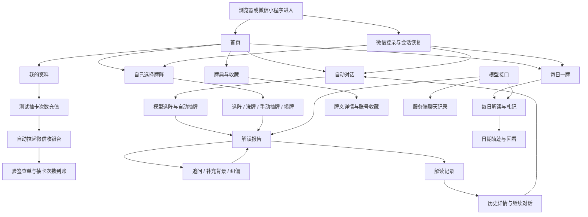

# 月映卡语业务流程全景与优化建议

更新日期：2026-09-12。初始梳理基线：`main` / `eebfc51`；合并 `origin/main` / `eae28bf` 后补充 F27 支付充值及本分支的返回按钮、抽牌动画变化。其他静态风险仍保留初始核对依据，不代表已对新增远端代码重新全面审计。

## 1. 阅读范围与结论

本文面向产品、设计、开发和测试，按用户希望完成的事情梳理流程。依据当前页面、交互组件、Hooks、API、存储实现及测试源码整理；已有文档只作为辅助，代码与旧文档冲突时以当前代码为准。

**核心判断：项目已经具备“提出问题 → 抽牌 → 获得解读 → 继续追问 → 保存与回看”的主闭环。下一阶段应优先解决中断后的状态一致性、用户输入与进度保护、记录恢复效率，再扩展新的功能。** 每日一牌、札记、牌典与收藏构成另外的使用场景，但尚未形成统一的长期回访体验。

边界说明：

- **已确认**：由本次实际阅读的代码直接支持。
- **静态风险**：由调用关系、数据更新顺序或状态条件推导，尚未在本次任务中运行故障复现。
- **产品建议**：拟议改进，不代表已有功能，也不代表用户已经批准实施。
- 本次只编写文档；没有调用真实模型、修改账号数据、迁移数据库或重新部署。没有把既有测试文件的存在写成“本次测试通过”。
- 没有线上访问量、转化率、成本和留存数据，优先级依据流程阻断程度、内容丢失风险及影响范围制定，不虚构收益百分比。
- “全部流程”覆盖当前仓库可识别的用户入口、操作分支、服务接口和运行维护链路，不代表仓库外另有的运营系统或线上部署都已核验。

### 1.1 优先级

| 优先级 | 判断标准 | 本文中的处理方式 |
| --- | --- | --- |
| P0 | 存在明确的账号越权、不可恢复的数据损坏或核心功能普遍不可用 | 本次没有足够证据认定这类线上事故，不强行列 P0 |
| P1 | 会影响结果可信度、内容保存、主要任务完成或恢复能力 | 优先验证并修复，依赖产品决策的项目先确定行为 |
| P2 | 流程可完成，但理解、查找、操作或维护成本可以降低 | 在主链路稳定后安排 |
| P3 | 需要用户需求或规模数据支持的扩展 | 先验证需求，避免提前增加系统复杂度 |

## 2. 业务全景

图中的登录连接表示身份前提，不代表登录成功后会同时跳转多个页面。首页和牌典可浏览；`/agent`、`/reading`、`/daily`、`/history` 及其子路由受登录保护。个人页自行展示登录或资料状态。依据：[UserSession](../components/session/UserSession.tsx)、[首页](<../app/page.tsx>)。

### 2.1 流程目录

| 编号 | 流程 | 主要入口 | 完成结果 |
| --- | --- | --- | --- |
| F01 | 首页发现与功能分流 | `/`、主导航 | 进入自动对话、手动抽牌、今日、牌典、轨迹或我的 |
| F02 | 微信登录与网页身份交接 | 小程序首页、认证 API | 网页持有有效账号会话 |
| F03 | 登录检查、失效与恢复 | `UserSession`、API 客户端 | 正确显示账号状态并恢复受保护流程 |
| F04 | 提问、开头辅助与感受补充 | `/agent`、`/reading` | 形成用户确认后提交的问题 |
| F05 | 自动选阵、抽牌与首次解读 | `/agent` | 获得带牌面的首轮报告 |
| F06 | 手动选阵与洗牌 | `/reading` | 选定牌阵并进入抽牌阶段 |
| F07 | 手动抽牌、撤回与重选 | 半圆牌堆 | 按牌位取得足量不重复的牌 |
| F08 | 揭牌与进入解读 | 揭牌阶段 | 牌面完整揭示并开始生成 |
| F09 | 报告阅读与信息分层 | 自动、手动报告 | 理解现状、下一步及牌义依据 |
| F10 | 继续追问与补牌 | 报告底部输入区 | 获得与已有上下文相关的后续回答 |
| F11 | 补充背景与纠偏 | 追问辅助操作 | 更新事实背景并继续讨论 |
| F12 | 停止、失败、重试与重新开始 | 生成中及结果页 | 恢复任务或明确开始新任务 |
| F13 | 解读保存与状态同步 | 首轮、揭牌、追问 | 记录归属正确账号并可恢复 |
| F14 | 历史列表与详情 | `/history`、`/history/[id]` | 找到并读懂过去的解读 |
| F15 | 历史续聊 | 历史详情 → `/agent` | 在原问题上下文中继续 |
| F16 | 聊天记录回看与数据删除 | `/history/messages` 等 | 回看请求记录或删除明确范围的数据 |
| F17 | 每日牌与日期回看 | `/daily` | 显示所选日期的牌和基础牌义 |
| F18 | 每日 AI 解读 | 每日页生成按钮 | 获得并保存当天指引 |
| F19 | 札记编辑、自动保存与恢复 | 每日札记 | 按账号和日期保存个人记录 |
| F20 | 旧设备札记导入 | 每日页导入提示 | 明确归入当前账号且不覆盖冲突内容 |
| F21 | 牌典浏览、详情与收藏 | `/library` | 学习牌义并管理喜欢的牌 |
| F22 | 个人资料与头像 | `/profile`、`/profile/avatar` | 保存昵称和头像 |
| F23 | 小程序前后台切换、重连与分享 | 原生容器生命周期 | 保持网页体验或恢复到安全入口 |
| F24 | 模型配置、请求、流式归档 | `/api/config`、`/api/interpret` | 生成请求可追踪、失败可定位 |
| F25 | 图片读取与资源同步 | 图片 API、同步脚本 | 牌面、品牌素材和头像可用 |
| F26 | 初始化、迁移、构建与运行 | npm 脚本、数据库迁移 | 以正确配置运行可核验的版本 |
| F27 | 测试抽卡次数充值、支付与到账查询 | 我的抽卡次数、小程序充值页 | 支付结果经服务端核验后只记账一次 |

### 2.2 数据对象与边界

| 对象 | 权威位置 | 写入时机与用途 | 需要避免的误解 |
| --- | --- | --- | --- |
| 账号、会话、登录票据 | PostgreSQL 用户、会话、票据表 | 微信身份交接、登录检查 | 票据是一次性交接凭证，不是业务记录 |
| 当前自动对话与输入草稿 | `AgentChatSession` 内存 | 客户端跨路由保留 | 跨路由保留不等于关闭页面后仍完整恢复 |
| 手动抽牌阶段 | `useReading` / `useManualDraw` 页面状态 | 当前手动流程 | 尚未持久化的阶段不能承诺刷新后恢复 |
| 解读记录 | `tarot_readings.data` | 问题、牌阵、牌面、解读、追问 | 与“收藏某张塔罗牌”是两件事 |
| 请求聊天记录 | `tarot_chat_messages` | 服务端独立记录输入、流式输出及状态 | 不等同于完整的业务会话列表，内部决策记录对列表隐藏 |
| 每日牌、解读与札记 | `tarot_daily_entries` | 按用户、日期登记和更新 | 日期对应牌面相同，个人札记仍按账号隔离 |
| 札记未保存草稿 | `UserSession.dailyDrafts` 内存 | 防抖保存失败或路由切换时保留 | 不是持久的离线备份 |
| 收藏牌 | 用户收藏关系 | 收藏与取消收藏 | 不是收藏解读、不是解读历史 |
| 图片元数据 / 文件实体 | PostgreSQL / OSS | 资源同步与头像写入 | 数据库迁移完成不代表图片已上传 |

依据：[数据库建表](../database/001_users_and_chat.sql)、[每日记录表](../database/005_daily_entries.sql)、[收藏表](../database/007_card_favorites.sql)、[AgentChatSession](../components/session/AgentChatSession.tsx)、[聊天归档](../lib/server/chat.ts)。

## 3. 获客入口与身份

### F01 首页发现与功能分流

**当前流程**：访问首页 → 主按钮“说说正在困扰你的事”进入 `/agent?new=1` → 次按钮“自己选择牌阵”进入 `/reading`；每日卡片进入 `/daily`；主导航提供首页、对话、今日、牌典、轨迹、我的六个入口。下方“开启旅程”进入 `/agent`，部分介绍卡只有说明文字。

**分支与边界**：主按钮显式表达新对话意图，而导航“对话”和下方入口没有 `new=1`。用户可能从不同入口回到已有会话，也可能进入新建确认逻辑；不能把所有“进入对话”都写成新建。首页的每日预览只计算日期牌，不写入每日记录。

**优化建议**：

- **P2**：当有进行中或可继续的对话时，首页明确区分“继续上次对话”与“开始新对话”，减少入口语义差异造成的困惑。
- **P2**：为自动与手动入口各补一句差异说明，例如“直接获得解读”和“自己选阵与抽牌”；不增加强制教学页。
- **P3**：先记录入口曝光、点击和首轮完成漏斗，再判断是否需要减少首页介绍区。当前没有数据支持重新设计整个首页。

**验收**：有无历史会话两种状态下，入口文案与实际行为一致；所有主要入口可在手机操作；未登录用户得到可完成的登录指引而非无说明的失败。

依据：[HomeHero](<../app/_components/home/HomeHero.tsx>)、[首页](<../app/page.tsx>)、[MainNav](../components/layout/MainNav.tsx)、[DailyCardPreview](../components/daily/DailyCardPreview.tsx)。

### F02 微信登录与网页身份交接

**当前流程**：小程序根据环境选择站点 → `wx.login` 获取 code → `POST /api/auth/wechat` → 服务端调用微信接口 → 按 AppID 与 OpenID 识别/创建账号 → 签发短期一次性 ticket → web-view 进入消费接口 → 原子消费 ticket、建立会话 → 设置 HttpOnly、SameSite Cookie → 303 返回允许的站内页面。

**分支与边界**：账号初次建立使用默认昵称和头像；票据数据库只存哈希，微信 `session_key` 不返回浏览器。无效、过期、重复消费票据返回认证错误；微信配置缺失与微信服务请求失败有不同后端状态。默认头像资源也必须完成初始化。

**优化建议**：

- **P1**：将站点配置、微信登录、票据兑换和网页加载失败分开提示；每层给出用户可操作的重试入口及脱敏问题编号。
- **P2**：明确浏览器独立访问的登录边界。当前主要登录入口依赖微信小程序，应提供清楚的进入说明；只有确认独立 H5 使用需求后再增加其他身份方式。

**验收**：首次与再次登录指向同一账号；重复 ticket 不能建立第二次会话；无效回跳不能跳外域；每种失败可重试且不重复创建用户；不把秘密值写入日志或文档。

依据：[小程序入口](../miniprogram/pages/index/index.js)、[认证服务](../lib/server/auth.ts)、[票据消费](../app/api/auth/wechat/consume/route.ts)、[回跳校验](../lib/auth/redirect.ts)。

### F03 登录检查、失效与恢复

**当前流程**：页面路径变化或用户重试 → `/api/auth/me` → 成功更新用户资料 → 受保护页面正常显示。确认 401 才清空登录状态及每日内存草稿，并尝试微信桥重新登录；网络/服务错误保留已有状态，显示重试。

**分支与边界**：恢复标记防止重复重启；可回到原路径。当前业务请求的 401 没有全部统一触发会话恢复；长期停留同页的过期行为与换页检查不完全一致。没有发现退出登录、注销、导出全部账号数据的现行入口。

**优化建议**：

- **P1**：统一业务 API 的会话过期通知，并区分本站会话失效与模型服务商密钥错误。身份恢复成功后只有确认仍是同一账号才恢复旧草稿。
- **P1**：给待提交问题和札记明确的保存/复制恢复路径。当前 401 清空内存草稿是事实，不能向用户承诺过期后草稿始终保留。
- **P2**：建立适度的会话失效刷新策略，避免每次标签切换都读取完整资料和收藏列表；需要时补充退出和账号数据管理能力。

**验收**：同页停留至过期后，提交追问、札记、收藏均进入一致恢复流程；网络 503 不被误判为退出；上游模型 401 不触发微信重登录；切换账号不泄露旧账号输入。

依据：[UserSession](../components/session/UserSession.tsx)、[微信恢复](../lib/auth/wechat-recovery.ts)、[API 客户端](../lib/api/client.ts)、[错误分类](../lib/api/errors.ts)。

## 4. 提问、抽牌与解读

### F04 提问、开头辅助与感受补充

**当前流程**：输入问题 → 可选从一件事、一个选择、一段关系开始 → 可选预设/自定义感受 → 填入草稿 → 用户修改并主动提交。辅助项不会自动发送；空白内容不能提交。

**分支与边界**：自动模式检查 AI 配置可用性；手动模式允许先进行选阵和抽牌，到解读时检查。自动问题草稿由全局会话持有，手动草稿属于页面状态。

**优化建议**：

- **P1**：统一两种入口的草稿保护，明确刷新、关闭、重新登录和新建时的保留/清除规则，按账号隔离恢复。
- **P1**：手动入口提前告知模型暂不可用，同时允许继续选阵仪式；不要让用户完成长流程才第一次知道无法生成。
- **P2**：补充“发生了什么、想获得什么帮助”的可跳过提示，辅助用户填写事实；不自动改写输入，也不强制完成问卷。

**验收**：辅助只填草稿；重复追加不产生重复片段；用户输入不被后来的异步状态覆盖；两模式无效输入规则一致；服务不可用恢复后保留原问题与牌。

依据：[QuestionWelcome](../components/question/QuestionWelcome.tsx)、[DraftAids](../components/question/DraftAids.tsx)、[自动入口](<../app/agent/page.tsx>)、[手动入口](<../app/reading/page.tsx>)。

### F05 自动选阵、抽牌与首次解读

**当前流程**：提交问题 → 创建用户消息和运行中回复 → 模型从可选牌阵选择并说明理由 → 本地随机洗牌和抽取 → 固定正逆位 → 保存问题、牌阵、牌面和空正文 → 第二次模型请求生成解读 → 保存结果。正常首轮包含选阵、正文两次模型请求。

**分支与边界**：选阵失败或无法解析时回退三张牌阵；用户取消不回退。初始记录保存失败会阻止生成。自动模式跨客户端路由保留会话并继续请求，但不保证系统回收页面后继续。新对话遇到生成或草稿会确认，已存档记录保留。

**优化建议**：

- **P1**：记录推荐来源与默认回退原因；界面不能在回退时暗示模型已完成推荐判断。
- **P1**：修复部分断流后业务状态仍可能标记 `done` 的路径，详见第 8 节；保存成功不代表生成完整。
- **P2**：分别测量选阵、初始保存、首字、首段可读正文耗时，确定瓶颈后优化。保留牌面先落库的保护，不为减少表面等待直接删除持久化步骤。

**验收**：正常、无效选阵、选阵网络失败、取消、初次写库失败均可解释；无重复牌；固定后的正逆位不变；默认回退有来源；断流不误标完整。

依据：[agentTurn](../lib/agent/agentTurn.ts)、[选阵解析](../lib/agent/spreadChoice.ts)、[抽牌](../lib/tarot/draw.ts)、[useAgentChat](../hooks/useAgentChat.ts)、[AgentChatSession](../components/session/AgentChatSession.tsx)。

### F06 手动选阵与洗牌

**当前流程**：问题提交 → 选择六种现有牌阵之一 → 确认牌阵 → 洗牌 → 完成后开始抽牌。修改问题或牌阵会重置牌堆，已建立牌堆时先确认。

**分支与边界**：这里选择的是观察角度和牌位数量，不直接保证解读质量。手动重抽保留问题、牌阵，再进入洗牌；自动重抽会重新选阵，两者不能共用含糊的说明。

**优化建议**：

- **P2**：牌阵说明突出“适用的问题、牌位含义、交互复杂度”，帮助用户按需要选择，不暗示牌越多越准确。
- **P2**：允许简洁仪式模式；减少等待或操作步骤时仍复用同一个固定牌堆，不因跳过动画重新随机。
- **P1**：对重置行为明确保留与清除项，并与 F07 的阶段恢复配套。

**验收**：所有牌阵按配置显示和抽取数量；重复确认不重复洗牌；改问题/牌阵取消后原选择不变；简洁与完整模式遵守相同领域规则。

依据：[牌阵定义](../lib/tarot/spreads.ts)、[SpreadSelector](../components/drawing/SpreadSelector.tsx)、[CardDeck](../components/drawing/CardDeck.tsx)、[手动页](<../app/reading/page.tsx>)。

### F07 手动抽牌、撤回与重选

**当前流程**：进入半圆牌堆 → 查看、拨动、缩放牌堆 → 预选 → 再次轻点或向外拖出 → 牌背飞出、放大停留、收拢至进度区 → 更新计数 → 重复直到牌数满足 → 最后一张动画结束后进入揭牌。支持触控和键盘操作；动画期间锁定重复抽取及修改操作；减少动态效果时改为定点淡入淡出，不支持动画时直接确认。

**分支与边界**：未揭牌前可撤回调整；第一次揭牌前尚未创建历史记录。刷新或离开会丢失这段页面内进度，当前没有手动阶段恢复入口。

**优化建议**：

- **P1**：保存可恢复的阶段快照，至少包含问题、牌阵、当前阶段和已固定牌面；若保存牌堆以恢复预揭牌流程，应明确生成后固定规则及账号归属。
- **P1**：离开时有可恢复结果则告知恢复位置；确实无法恢复时才针对性提示，避免每一步都弹确认。
- **P2**：保留简明的选中/确认反馈及键盘替代路径，测量误触和撤回情况后再调整手势阈值。

**验收**：快速双击不重复抽牌；边缘牌可选；缩放后触点对应正确牌；刷新、后台回收、返回分别按约定恢复；恢复不会让已固定牌面改变。

依据：[FanDeck](../components/cards/FanDeck.tsx)、[useManualDraw](../hooks/useManualDraw.ts)、[手动状态机](../lib/tarot/manual-draw.ts)、[手动页面](<../app/reading/page.tsx>)。

### F08 揭牌与进入解读

**当前流程**：抽齐 → 展示牌阵 → 逐张揭开或全部揭开 → 首次揭牌固定本轮完整牌面并建立初始历史 → 全部揭开后开始生成 → 报告页。

**分支与边界**：尚未揭开任何牌可以返回调整；揭开一张后不再允许替换牌面；只揭一部分不能进入完整解读。模型或存储失败需保留牌面，不要求重新抽。

**优化建议**：

- **P1**：在首次揭牌前简要说明“揭牌后本轮牌面固定”，并在存档失败时明确提示及可重试动作。
- **P1**：刷新恢复时区分“已抽齐未揭”“部分揭牌”“已揭完待解读”，不要把这些状态一律恢复成新的抽牌。
- **P2**：优化继续解读按钮的状态说明，让用户知道剩余揭牌数、是否正在保存、是否服务不可用。

**验收**：首次揭牌只建档一次；固定后不能替换；全部揭开才生成；存档失败可恢复同一牌组；连续点击不重复发起解读。

依据：[RevealStage](../components/drawing/RevealStage.tsx)、[useReading](../hooks/useReading.ts)、[手动领域状态](../lib/tarot/manual-draw.ts)。

### F09 报告阅读与信息分层

**当前流程**：等待态 → 有正文后展示“事情怎么看”“可以怎么做”两章 → 标签、翻页或横滑切换 → 长内容展开/收起 → 查看牌义依据与牌阵 → 可以重新解读、重抽或追问。用户主动浏览时暂停自动滚动并提供回到最新入口。

**分支与边界**：未识别成结构化章节的旧文本按完整正文显示；缺少某章会提示尚未生成。提示词已有承认信息不足、尊重用户纠正、避免编造事实的规则；需要评估遵循效果，不能把这些规则说成尚未存在。行动建议目前是文本，没有独立行动对象或完成状态。

**优化建议**：

- **P1**：将请求结束、文本存在、报告完整三件事分别判断；章节缺失时清楚说明并支持保持牌面补全。
- **P1**：同牌重新解读保留上一版，至少新版本完成前能回看；追问应能追溯引用的版本。
- **P2**：用典型场景评测“事实对应、可执行性、信息不足时的表达、纠正是否生效”，不要只用字数判断报告质量。
- **P3**：先验证用户复盘需求，再增加将一项建议关联札记或进展的动作；不自动创建提醒或任务。

**验收**：有思考无正文、缺核心、缺行动、旧格式、超长正文、中途断流均可读且状态准确；阅读旧段落时不被强制滚动；重新解读后原牌不变，旧版本可追溯。

依据：[ReadingReport](../components/reading/ReadingReport.tsx)、[内容解析](../lib/interpretation.ts)、[Interpretation](../components/reading/Interpretation.tsx)、[提示词](../lib/api/prompts.ts)。

### F10 继续追问与补牌

**当前流程**：首轮达到可追问状态 → 用户提交追问 → 模型判断直接回答或补 1–3 张 → 使用原问题、原牌、主解读和有效历史追问生成回答 → 保存到原记录。自动模式补牌后直接生成；手动模式的补牌由系统抽取，但需用户揭开才继续。

**分支与边界**：补牌抽定后先保存；已有决策/牌面重试优先复用。手动补牌未揭时禁止继续发送。Agent 决策解析失败默认直答，手动解析失败报错；两种入口的回退策略不同。

**优化建议**：

- **P1**：补牌复用主抽牌已有的 Fisher–Yates 洗牌。当前两份补牌实现使用随机 comparator 排序，抽取机制不一致。
- **P1**：统一决策失败策略并记录原因，避免相同问题在两入口遇到同类故障后表现无说明地不同。
- **P2**：明确是否允许本轮补牌重复原牌或往轮牌；这是业务规则，应先确定再写测试，不能通过临时过滤暗自改变。
- **P2**：按实际需求允许用户选择沿原牌继续或确认补牌，保留已有上下文，不因增加牌数替代对现实事实的澄清。

**验收**：直答不抽新牌；补牌数量符合决定；补牌重试不换牌；同轮无重复；决策失败保留问题；正逆位及跨轮重复规则有明确测试。

依据：[追问编排](../lib/agent/agentTurn.ts)、[抽牌工具](../lib/tarot/draw.ts)、[手动追问](../hooks/useReading.ts)、[追问面板](../components/reading/FollowUpPanel.tsx)、[历史上下文](../lib/followUpHistory.ts)。

### F11 补充背景与纠偏

**当前流程**：选择“这个理解不符合”“补充情况”“具体怎么做”等辅助 → 填入可编辑草稿并标记直答 → 用户确认发送 → 跳过补牌判断 → 提示词优先使用最新纠正和现实进展。历史续聊还提供记录尝试、更新进展类草稿。

**分支与边界**：历史上下文只纳入成功且无错误/截断的追问轮次，失败轮中的用户新事实也可能一起被排除。辅助设置的 `directDraft` 是隐含状态，草稿未清空时即使被大量改写也可能继续沿直答路径。

**优化建议**：

- **P1，静态风险**：将用户事实与模型回复分别保存/筛选；模型失败不能顺带丢弃用户已提供的纠正。
- **P2**：让“直接回应/允许补牌”成为用户可见、可撤销的状态，或在大幅修改草稿时按明确规则重置。
- **P2**：建立纠偏场景验收集：关系判断被纠正、用户已执行建议、旧行动失效、事实不足；核验输出而不是只核验提示词存在。

**验收**：用户纠正后模型失败，下一轮仍保留纠正；失败模型内容不升级为事实；修改辅助草稿不产生无法理解的模式；新事实优先于旧模型推断。

依据：[DraftAids](../components/question/DraftAids.tsx)、[Agent 草稿分流](<../app/agent/page.tsx>)、[有效追问筛选](../lib/followUpHistory.ts)、[追问提示词](../lib/api/prompts.ts)。

### F12 停止、失败、重试与重新开始

**当前流程**：用户停止或请求失败 → 保留已抽牌和已有正文 → 显示原因 → 对可重试错误自动重试或提供手动重试。已有正文的读取异常可返回部分结果而不抛异常。同牌重解保持问题/牌阵/牌面；重抽、新对话有不同保留规则。

| 操作 | 原问题 | 牌阵/牌面 | 已保存历史 |
| --- | --- | --- | --- |
| 停止生成 | 保留 | 保留已抽部分 | 保留已落库内容 |
| 同牌重新解读 | 保留 | 保留 | 更新原记录，当前未见完整版本历史 |
| 自动模式重新抽牌 | 保留原问题发起新轮 | 重新选阵并抽牌 | 原轮保留 |
| 手动模式重新抽牌 | 保留 | 保留牌阵，重新洗牌 | 原历史保留 |
| 新对话 | 开始新问题 | 重新开始 | 不删除已保存记录 |

**优化建议**：

- **P1**：生成失败与保存失败提供不同重试；正文已完整时可以只重试保存，避免不必要的模型请求和内容变化。
- **P1**：统一状态机，使取消、部分结果、截断、失败、成功都有明确终态；不能靠是否抛异常判定成功。
- **P1**：自动模式跨路由继续、手动模式卸载取消的差异需要明确告知，并配套恢复能力。
- **P2**：长对话达到实际性能或上下文瓶颈后再采用可追溯摘要，保留用户事实和最近进展，不把模型猜测写成既定事实。

**验收**：在首字前、部分正文后、最后一段前、数据库保存时分别注入故障；重试不换牌、不串记录、不重复计数；停止后状态和历史一致；只重试保存不调用模型。

依据：[stream-client](../lib/api/stream-client.ts)、[useAgentChat](../hooks/useAgentChat.ts)、[useReading](../hooks/useReading.ts)、[手动报告](../components/reading/ManualReadingReport.tsx)。

## 5. 保存、历史与恢复

### F13 解读保存与状态同步

**当前流程**：自动解读在取得牌阵/牌面后先保存初始记录，再生成正文；手动流程首次揭牌建立记录。客户端继续更新解读及追问，服务端同时独立归档每次模型请求；主解读通过当前 `exchangeId` 将流式正文写回对应记录。

**分支与边界**：业务记录和聊天归档可能处于不同完成进度；客户端保存失败不等同于模型失败。服务端定期写快照和结束状态，但进程崩溃可能留下 `pending`。`tarot_users` 的累计占卜次数在新建解读记录时增加，空正文也计数；同记录更新、追问、每日牌不增加，删除不扣减。

**优化建议**：

- **P1**：为解读自身保存独立的生成状态、当前尝试标识和版本，避免依赖其他列表才能确定是否完成。
- **P1**：界面分别显示“生成中/已生成”和“保存中/已保存/保存失败”，让用户知道何时可以放心关闭。
- **P2**：将“占卜次数”说明为累计发起并建立记录的探索次数；如果需要完成次数，应另外定义和统计，不能悄悄改变现有数字含义。

**验收**：模型成功但保存失败、初始保存失败、刷新、中断、重试、删除历史分别核验；同一尝试不会重复计数；旧流不能覆盖新尝试；完成状态不依赖聊天记录是否被清空。

依据：[useAgentChat](../hooks/useAgentChat.ts)、[useReading](../hooks/useReading.ts)、[readingStorage](../lib/readingStorage.ts)、[聊天归档](../lib/server/chat.ts)、[计数触发器](../database/006_user_reading_count.sql)。

### F14 历史列表与详情

**当前流程**：进入轨迹 → `getReadings()` 按后端每页 50 条循环读取所有页 → 全部读完后展示 → 按牌数组织视觉层级 → 点击记录 → 查看原问题、牌阵、牌面、解读、追问和补牌；缺少正文时提示解读未完成。

**分支与边界**：当前没有关键词搜索与日期筛选；接口分页不等于界面按需加载。详情请求失败的顶层标题仍可能显示“记录不存在”，即使实际是网络故障，这属于待改进的错误表达。

**优化建议**：

- **P1**：首屏只请求一页摘要，按需加载更多；采用稳定游标，避免新记录插入导致 offset 翻页重复或漏项。
- **P1**：区分真实 404、无权限、网络暂不可用和服务错误，提供原地重试，不把临时失败呈现为数据消失。
- **P2**：增加问题关键词、日期和完成状态筛选；将“继续聊这件事”作为记录的明确后续操作。

**验收**：使用 1000 条测试记录时首屏只读一页；追加分页无重复；并发新增不破坏定位；503 显示可重试，404 才显示不存在；搜索在服务端执行而非先下载所有全文。

依据：[历史列表](<../app/history/page.tsx>)、[历史客户端](../lib/readingStorage.ts)、[历史 API](../app/api/readings/route.ts)、[详情](<../app/history/[id]/page.tsx>)。

### F15 历史续聊

**当前流程**：详情点击“继续聊这件事” → `/agent?readingId=...` → 相同记录在内存中时保留实时状态 → 否则读取解读 → 用 `exchangeId` 分页查聊天记录 → 判定 complete / incomplete / unknown → 恢复主解读、追问及原牌。

**分支与边界**：不完整记录保留正文并提供重试；找不到关联状态时显示无法确认提示。清空聊天不会删除解读文本，但会影响当前完成状态判断。手动历史也可通过自动对话页续聊，不能写成返回手动抽牌全过程。

**优化建议**：

- **P1**：将状态并入单条解读查询，或增加按 exchange ID 查询接口；不为恢复一条记录扫描整个账号的聊天历史。
- **P1**：续聊只使用已确认有效的上下文；对中断部分明确标记，允许同牌重试后继续，而非将片段当完整结论。
- **P2**：进入历史续聊时显示原问题、创建日期和已续聊次数，帮助用户确认正在继续哪件事。

**验收**：大量历史下恢复请求数保持有界；完整、中断、无关联、聊天已清空均有明确行为；恢复相同在途记录不会重复启动模型请求或打断原流。

依据：[readingResume](../lib/readingResume.ts)、[Agent 页面](<../app/agent/page.tsx>)、[会话恢复](../hooks/useAgentChat.ts)。

### F16 聊天记录回看与数据删除

**当前流程 A：聊天回看**：`/history/messages` 每页取 50 条独立问答消息 → 展示角色、时间、正文、生成状态 → 加载更早记录。内部决策消息被过滤。清空需要确认，只删除当前账号的聊天记录。

**当前流程 B：解读删除**：轨迹选择单条或多条，或清空全部；详情也能删当前记录 → 二次确认 → API 按账号删除 → 刷新列表/返回轨迹。批量每请求最多 500 条，客户端超过后分批串行执行。

| 用户操作 | 解读记录 | 聊天消息 | 每日记录/札记 | 收藏牌 | 累计探索次数 |
| --- | --- | --- | --- | --- | --- |
| 删除/清空解读 | 删除目标范围 | 保留 | 保留 | 保留 | 不扣减 |
| 清空聊天记录 | 保留 | 删除该账号全部 | 保留 | 保留 | 不扣减 |
| 取消收藏 | 保留 | 保留 | 保留 | 仅取消对应牌 | 不变 |
| 将札记清空保存 | 保留 | 保留 | 札记清空，日期记录仍在 | 保留 | 不变 |

**分支与边界**：分批删除中途失败不会回滚此前成功批次；没有发现回收站。聊天清空确认中“已收藏的解读记录”与当前自动保存解读、收藏牌面两套概念混淆。正在生成时从其他页面清空聊天，还需明确与在途归档的协调规则。

**优化建议**：

- **P1**：删除弹窗按上表说明范围，统一“解读记录/聊天记录/牌面收藏”的术语。
- **P1**：删除添加独立在途状态及防重复操作；批量失败仍同步成功批次，剩余可重试。
- **P2**：聊天以一轮问答或业务会话分组，提供定位解读入口；删除会话时协调正在生成的请求。
- **P3**：有明确误删反馈后再引入短期撤销/回收站，并单独定义永久删除行为。

**验收**：501 条测试删除在第二批故障时准确展示剩余项；不误删其他账号；清空聊天后解读仍可读；生成与删除并发结果明确；文案与实际保留项一致。

依据：[历史列表](<../app/history/page.tsx>)、[历史存储](../lib/readingStorage.ts)、[解读 API](../app/api/readings/route.ts)、[聊天页面](<../app/history/messages/page.tsx>)、[消息 API](../app/api/messages/route.ts)。

## 6. 每日陪伴、学习与资料

### F17 每日牌与日期回看

**当前流程**：进入 `/daily` → 浏览器挂载后取得本地日期 → 通过日期种子确定牌面和正逆位 → 自动揭牌并展示关键词、基础含义 → 登记当前账号的日期记录 → 可选择最近 14 天中的某日或返回今天。

**分支与边界**：同一日期的所有用户得到同一张牌及方向；不是为每个账号独立随机抽取。14 日列表由算法计算，不代表这 14 天都曾访问或产生过记录；札记标记来自云端记录。切换日期会取消当前每日解读请求。数据库记录按账号和日期保存。

**优化建议**：

- **P1，静态风险**：每日页的 `todayKey` 只在挂载时初始化，首页预览已有午夜、重新可见刷新。复用日期刷新逻辑，并在用户编辑历史札记时只更新“今天”的标记，不强制切走正在编辑的日期。
- **P2**：说明“每日共同主题牌”的定位，避免用户把它理解为个人命运预测；如未来希望个性化，须先决定规则及历史兼容方式，不能直接改随机算法。
- **P2**：有实际回看需求时提供月份/日期选择与“有札记”筛选。14 天只是当前入口范围，不应让用户误以为旧札记已被删除。

**验收**：跨本地午夜、切后台再返回、跨月、浏览过去日期时，日期标签和今日牌一致；切换不会串写札记；同日期前后端牌面一致；超过 14 天的保存数据不因界面切换被清除。

依据：[每日页](<../app/daily/page.tsx>)、[日期算法](../lib/tarot/daily.ts)、[首页午夜更新](../components/daily/DailyCardPreview.tsx)、[每日登记接口](../app/api/daily/[date]/route.ts)。

### F18 每日 AI 解读

**当前流程**：先读取已有每日解读 → 用户点击生成或重新解读 → 确保日期记录存在 → 发送每日模式请求 → 服务端按日期重新计算权威牌面 → 流式显示内容 → 服务端保存文本和 `pending / done / error / cancelled` 状态。

**分支与边界**：已有不完整记录会提示可重试；切换日期或离开页面会取消请求；较新的请求通过 `exchange_id` 获得该日结果的写入权，旧流只保留聊天归档，避免覆盖新结果。服务端不信任客户端传入的每日牌面。

**优化建议**：

- **P1，静态风险**：页面将 `onThinking` 和 `onContent` 都直接追加到同一显示字符串，而服务端归档对思考段增加独立标记。应采用与主解读一致的思考/正文分离方式，避免首次显示与刷新后显示结构不同。
- **P2**：提供明确“停止生成”操作；当前取消主要发生在切日期或卸载，用户控制不够直接。
- **P2**：重新解读时保留上一版可读内容，在新结果完成后再替换或允许回看，明确这会产生一次新的生成请求。

**验收**：使用含思考段、正文、错误事件和突然断流的模拟 SSE 分别验证；首次显示与刷新后正文一致；旧请求不能覆盖新请求；停止后可看到已保存内容及真实状态。

依据：[每日页生成逻辑](<../app/daily/page.tsx>)、[解读 API](../app/api/interpret/route.ts)、[服务端归档](../lib/server/chat.ts)。

### F19 札记编辑、自动保存与恢复

**当前流程**：按日期读取札记 → 用户输入 → 800ms 防抖 → 串行保存到 `/api/daily/[date]` → 显示待保存、已保存或失败 → 通知其他区域更新札记标记。切换日期、页面隐藏和卸载会尝试刷新待保存队列。

**分支与边界**：输入上限 10000 字；全空白会被保存为空内容。读取失败可重试；保存失败保留当前会话草稿并提示重试或复制。版本号防止旧写入响应覆盖同一会话的新输入，但当前未见用于跨设备并发编辑的服务端版本冲突机制。浏览器关闭前的异步保存不能视为绝对可靠。

**优化建议**：

- **P1**：补充按账号隔离、有清理策略的持久草稿机制或明确的离线保存方案；以“服务端已确认”为已保存，不把请求发出等同于成功。是否保存敏感札记到设备应有清晰产品说明。
- **P2**：服务端使用版本号或更新时间条件更新，发生跨设备冲突时展示差异并让用户选择，避免静默后写覆盖。
- **P2**：14 日轨迹只需日期和是否有笔记；当前每次更新事件通过 `getAllDailyNotes()` 分页取所有日记录，建议增加日期范围或轻量索引读取，降低长期使用后的加载成本。

**验收**：快速输入、断网、切日期、刷新、关闭重开、两台设备同时编辑均有明确结果；旧账号草稿不会出现在新账号；保存状态与服务端结果一致。

依据：[useDailyNote](../hooks/useDailyNote.ts)、[dailyStorage](../lib/dailyStorage.ts)、[每日 API](../app/api/daily/[date]/route.ts)、[日记录列表](../app/api/daily/route.ts)。

### F20 旧设备札记导入

**当前流程**：发现旧 localStorage 札记键 → 明示“导入当前账号” → 用户主动导入 → 每批最多 100 条发送服务端 → 校验日期和内容 → 事务写入 → 云端已编辑日期不覆盖 → 仅删除本地成功导入部分，冲突继续保留。

**分支与边界**：格式错误保留原数据；部分批次失败可能已有前面批次落库；再次导入仍遵守不覆盖规则。冲突不会消失，但当前界面主要给数量反馈，没有逐日处理工具。

**优化建议**：

- **P2**：导入前展示当前账号、待导入日期数和冲突数；导入后列出成功、冲突、失败日期。
- **P2**：支持逐条查看冲突及复制内容，避免“冲突留在设备”成为没有出口的状态。
- **P2**：为批次进度和中断恢复提供可见反馈；格式损坏时可导出原始内容供用户保留，不自动丢弃。

**验收**：重复导入不覆盖云端已编辑内容；第二批失败后重试不丢数据；切换账号前后归属清楚；错误输入不会导致本地原数据被删除。

依据：[导入客户端](../lib/dailyStorage.ts)、[导入 API](../app/api/daily/route.ts)、[每日页导入界面](<../app/daily/page.tsx>)。

### F21 牌典浏览、详情与收藏

**当前流程**：进入 `/library` → 全部/大阿卡纳/四花色筛选 → 浏览牌面和名称 → 打开详情查看正逆位关键词及含义 → 可在列表或详情收藏/取消收藏 → 切换“我的收藏”再次筛选。

**分支与边界**：牌典可公开浏览，收藏依赖微信账号；收藏写入成功后更新用户状态，操作锁防止重复提交。失败显示提示。详情支持关闭、Esc、焦点约束与返回原焦点；图片有失败占位。当前没有按牌名或关键词搜索，也没有从详情直接带上下文进入对话的流程。

**优化建议**：

- **P2**：增加牌名、英文名和关键词搜索，并保留分类、收藏筛选和滚动位置，减少从 78 张牌中重新寻找的成本。
- **P2**：收藏提示应明确当前账号与保存结果；无账号时提供可执行的登录指引，登录后保留原选中牌。
- **P3**：验证学习需求后增加“围绕这张牌提问”，以草稿方式填入并由用户确认；不把用户浏览牌义自动转成付费模型请求。

**验收**：列表与详情收藏状态同步；筛选后数量正确；失败不虚增收藏；同账号刷新可恢复；未登录仍能浏览；关闭详情返回原位置。

依据：[牌典页面](<../app/library/page.tsx>)、[CardDetail](../components/cards/CardDetail.tsx)、[UserSession](../components/session/UserSession.tsx)、[收藏 API](../app/api/favorites/[cardId]/route.ts)。

### F22 个人资料与头像

**当前流程 A：资料**：进入我的 → 展示昵称、头像、累计占卜次数、相伴天数、珍藏牌面数 → 编辑昵称 → 前后端校验 → `PATCH /api/auth/me` → 返回最新资料并提示已保存。昵称允许 1–40 个 Unicode 码点，拒绝控制字符；相伴天数按北京时间自然日并包含注册当天。

**当前流程 B：头像**：进入头像页 → 选 JPG/PNG/WebP，原图不超过 5MB → 浏览器居中裁成 256×256 并预览 → 保存 → 服务端验证真实图片、大小及单帧要求，转 WebP → 上传 OSS → 登记资源并更新资料。支持取消和恢复默认头像。

**分支与边界**：未登录展示指引；上传失败不替换头像，但上传成功后写库失败可能残留孤立对象。每次保存新建资产，未发现引用回收流程。当前只有居中裁剪，无法手动调整人物位置。

**优化建议**：

- **P1**：解释统计口径，避免把累计建档次数当成功解读数；与 F13 统一定义。
- **P2**：昵称实时显示字符计数；头像允许拖动/缩放裁剪，预览与最终结果一致。
- **P2，静态风险**：资料保存整对象更新用户状态，而收藏单独修改字段；核验并发响应倒序是否覆盖新收藏，必要时改为字段级合并或版本保护。
- **P2**：头像保存明确反馈，离开时提醒未保存修改；“我的牌典”若意指收藏，应直接进入收藏筛选。资产回收统一纳入 F25。

**验收**：中文、emoji、超长和控制字符的前后端校验一致；资料/收藏并发更新不互相覆盖；取消保留旧头像；偏心人像可调整；上传失败可重试且不会显示假成功。

依据：[个人页](<../app/profile/page.tsx>)、[ProfileEditor](../components/profile/ProfileEditor.tsx)、[AvatarEditor](../components/profile/AvatarEditor.tsx)、[头像校验](../lib/server/avatar-image.ts)、[资料服务](../lib/server/profile.ts)、[用户会话状态](../components/session/UserSession.tsx)。

## 7. 小程序与运行支持

### F23 小程序前后台切换、重连与分享

**当前流程**：小程序只有一个原生 web-view 容器页，业务复用网页；加载/登录失败时显示原生错误与重试。卸载会取消在途请求并使旧回调失效；登录恢复通过重开原生首页，再回到安全的站内路径。分享统一指向首页，由接收者使用自己的微信身份进入。

**分支与边界**：分享不携带登录票据、用户问题或私人记录，没有“分享解读报告”的完整流程。网页跨路由保留自动对话，不代表系统回收 web-view 后仍保留内存。代码中体验版/正式版站点地址为空，只能认定当前源码未配置，不能认定外部线上环境不存在。

**优化建议**：

- **P1**：形成真机验收矩阵：前后台切换、键盘弹出、系统回收、过期重登、网络切换、SSE 中断、返回原路径；先保证可恢复而不是只检查首次打开。
- **P2**：前台恢复时按必要的节流策略检查会话与记录状态；避免反复重登录和重复创建解读。
- **P3**：如需分享结果，另行设计脱敏预览、可撤回链接和明确选择范围；不得把现有私有记录 URL 或票据直接分享。

**验收**：iOS 与 Android 微信真机分别留存结果；分享打开首页且无私人参数；系统回收后能找到已保存解读；短时间切换不触发重复登录；未覆盖的机型明确记录为未验证。

依据：[小程序容器](../miniprogram/pages/index/index.js)、[站点校验](../miniprogram/utils/web-view.js)、[小程序配置](../miniprogram/config.js)、[微信恢复](../lib/auth/wechat-recovery.ts)、[接入指南](./MINIAPP.md)。

### F24 模型配置、请求、流式归档

**当前流程**：私有服务端配置 → `/api/config` 返回轻量可用标记 → 用户提交 → `/api/interpret` 认证与校验 → 区分主解读、每日、追问或内部决策 → 建立聊天记录 → 请求上游模型 → 处理首响应超时、心跳及空闲超时 → SSE 转发 → 周期性快照与最终状态落库。

**分支与边界**：客户端可重试错误默认最多自动重试两次；已有正文发生部分中断时可保留片段。`available` 只代表模型基础配置可解析，不证明数据库、模型鉴权或网络健康。配置由服务端读取，忽略客户端模型覆盖。当前不设 AI 每小时次数配额是已明确的规则；不能把强制限额作为默认改造。

**优化建议**：

- **P1**：按明确业务模式进行服务端参数校验，验证牌阵、牌 ID、数量和输入大小；内部决策由服务端模板生成。当前常规参数校验较浅且 Agent 可传自由 prompt，不应只依赖前端约束。
- **P1**：分开会话失效、模型鉴权失败、上游不可达、流中断、数据库保存失败的错误码与恢复动作。
- **P1**：为崩溃后遗留的 `pending` 建立过期收敛规则与尝试标识；确保不完整生成可重试，不永久显示生成中。
- **P2**：记录脱敏请求 ID、业务模式、首字耗时、总耗时、重试次数、结果状态及上游有提供时的 usage；容量策略基于观测后决定，保持现有无小时配额规则。
- **P2**：为运维提供独立、受控的依赖健康检查，不向所有用户暴露配置详情或以页面加载触发真实模型探测。

**验收**：非法输入在创建聊天/调用模型前被拒绝；本站 401 与模型 401 采取不同操作；进程异常后旧 pending 能被识别；记录、展示、重试共享一致终态；指标不包含密钥和用户问题原文。

依据：[解读 API](../app/api/interpret/route.ts)、[流客户端](../lib/api/stream-client.ts)、[聊天归档](../lib/server/chat.ts)、[配置标记](../app/api/config/route.ts)、[错误分类](../lib/api/errors.ts)、[配置规则](./CONFIG.md)。

### F25 图片读取与资源同步

**当前流程**：迁移资源表 → `images:sync` 扫描图片并计算 hash → 已登记且对象一致时跳过，否则上传 OSS 后登记 → 兼容旧头像迁移 → 部分逻辑图片路径重写至 `/api/assets` → 查询资源表并 307 跳转 → `images:verify` 核验已登记对象的类型、大小、哈希与头像关系。

**分支与边界**：资源缺失返回 404，数据库故障可返回 503，没有自动本地回退。内容寻址支持长期缓存；不是所有品牌资源都必然走同一重写路径。旧版本与未引用对象不自动删除；上传成功但写库失败可能产生孤立对象。核验已登记对象不等于证明所有新源码引用的素材都已登记。

**优化建议**：

- **P1**：发布前核对当前资源清单、构建引用和同步结果，检查首页、牌典、抽牌、报告、默认头像的实际加载链路。
- **P2**：利用受控缓存或发布清单减少静态图片映射对数据库的频繁依赖，保留旧逻辑 URL 的兼容性。
- **P2**：先生成无引用资产报告，区分用户头像、静态映射、历史保留对象，再制定保留期与清理审批；本次不执行任何删除。

**验收**：新增素材漏同步能在发布前发现；旧历史牌图仍可加载；更新按约定时间生效；资源清理绝不删除仍被引用的头像；图片故障可区分缺资源、数据库故障和 OSS 不可达。

依据：[同步脚本](../scripts/sync-images.ts)、[验证脚本](../scripts/verify-images.ts)、[资源服务](../lib/server/image-assets.ts)、[资源路由](../app/api/assets/[...path]/route.ts)、[路径重写](../next.config.ts)。

### F26 初始化、迁移、构建与运行

**当前流程**：准备私有配置与数据库 → `db:migrate` 按文件名顺序执行数字前缀 SQL → 图片同步与核验 → 安装依赖、构建 → 按 Web/小程序模式读取 host、port 启动 → 反向代理支持同源 API 和 SSE → 分层验证登录、数据库、图片、模型及真机操作。

**分支与边界**：模型配置可以在后续请求读取；监听地址/端口改变需要重启。数据库配置变化会重建连接池。迁移每次重跑所有 SQL，当前未见迁移版本账本及统一并发锁。构建成功不代表外部服务联通。旧 `ApiSettings` 组件和 `/api/models` 兼容接口仍存在，但当前页面没有挂载用户密钥设置入口。

**优化建议**：

- **P1**：发布前整体校验配置与环境，阻止空正式地址；配置更新采用原子替换，避免请求读到半份配置。任何“保留上一份有效配置”策略必须显式设计，不能静默回退到示例值。
- **P1**：形成可执行的“备份 → 迁移 → 图片 → 构建 → 启动 → 登录/流式冒烟 → 放量”清单与失败回退条件；明确代码回退和数据库恢复是不同操作。
- **P2**：增加迁移版本、校验和、并发保护；历史迁移兼容保留，避免每次都执行已完成的数据变更。
- **P2**：确认遗留模型设置接口的实际调用者再决定保留或下线；不能在本次文档任务中顺手删除。
- **P2**：分层观测进程、数据库、资源、微信登录和模型链路，依据实际基线设置告警阈值。

**验收**：预发布完成一次升级及回退演练；并发迁移只执行一次；配置缺失得到准确错误且不泄露值；真实微信、数据库、图片、SSE 的验证结果分别记录，不用 build 结果替代。

依据：[package.json](../package.json)、[启动脚本](../scripts/run-next.mjs)、[配置读取](../scripts/config.mjs)、[迁移](../scripts/migrate-db.mjs)、[数据库连接](../lib/server/database.ts)、[模型列表兼容接口](../app/api/models/route.ts)、[配置指南](./CONFIG.md)。

### F27 抽卡次数购买、支付与到账查询

**当前流程**：已登录用户进入“我的 → 购买抽卡次数” → 读取启用的方案、余额与最近 10 笔订单 → 选择方案并提交方案 ID → 服务端按方案金额和抽卡次数创建订单快照 → 通过订单专属票据进入原生桥接并自动拉起微信收银台（无二次确认页） → 服务端主动查单及后台轮询 → 验签并核验订单、商户、金额和流水号 → 同一事务更新订单、写入账本并累加用户可用抽卡次数 → 页面自动刷新到账结果。默认方案为 5 次卡 ¥10.00 / 5 次、月订阅 ¥28.80 / 20 次、年订阅 ¥98.00 / 100 次。抽卡次数尚不抵扣解读或聊天。

**分支与边界**：连续创建复用仍有效且档位、商户相同的待付订单；票据只允许操作对应订单。支付取消、失败或查询暂不可用时不直接认定到账；失败订单展示经过映射的原因。订单过期限制继续付款，但仍允许查单确认迟到成功；后台轮询依赖常驻 Node 服务，事务与账本唯一键避免重复到账。通知地址允许为空，此时依赖主动查单；退款配置已保留，但未开放退款或抽卡次数扣回流程。商户权限、AppID 绑定及真机扣款结果需独立验收，不能从配置存在推断支付可用。

**优化建议**：

- **P1**：把“确认扣款”“等待到账”“已到账”“失败”“已过期但仍待确认”分别呈现，明确取消收银台不等于服务端确认失败，避免用户误以为需要重复付款。
- **P1**：记录待确认订单数量、最久等待时间和查单失败情况，并建立人工核对入口；若部署到无常驻进程的环境，应使用持久调度，不能依赖进程内计时器。
- **P1**：扩展到正式收费前明确抽卡次数用途、退款与扣回规则；金额和权益以订单创建时快照为准，退款也要提供唯一凭证及幂等记账。
- **P2**：充值记录超过 10 条后提供分页、按订单号定位与查询时间提示，降低查找和反馈成本。

**验收**：重复点击、支付取消、断网重试、票据过期及跨账号访问均符合边界；签名或金额不匹配不得到账；并发通知与查单、服务重启、迟到成功均只能记账一次。使用模拟网关验证逻辑后，再单独记录经用户确认的真机支付结果。

依据：[充值组件](../components/CreditRecharge.tsx)、[订单与账本](../lib/server/payments.ts)、[斗拱签名验签](../lib/server/huifu.ts)、[后台查单](../lib/server/payment-poller.ts)、[原生充值页](../miniprogram/pages/recharge/recharge.js)、[支付指南](./PAYMENTS.md)。

## 8. 优先核验的具体问题与证据

以下是代码级证据汇总，不是线上事故报告。行号对应本次代码基线；后续修改后需要重新定位。

| 问题 | 证据与触发条件 | 结论级别 | 对应流程 |
| --- | --- | --- | --- |
| 部分流中断后状态可能仍为 done | `stream-client.ts:354` 起保留部分文本并返回 `receivedError`；`agentTurn.ts:134` 起返回时未传该字段；`useAgentChat.ts:345` 起保存成功后标记 done；`app/agent/page.tsx:157` 以 done 控制发送 | 调用链已确认；状态影响为静态推导，待故障注入复现。页面仍有错误提示，不能写成无提示成功 | F05/F10/F12 |
| 用户纠正可能随失败轮一起排除 | `lib/followUpHistory.ts:12` 起只接受成功、无错误/截断的轮次 | 筛选规则已确认；实际模型是否忽略纠正需场景测试 | F11 |
| 补牌与主抽牌随机方式不一致 | `lib/tarot/draw.ts:18` 主牌 Fisher–Yates；`:62` 补牌随机 comparator；`hooks/useReading.ts:44` 另有补牌实现 | 代码事实；不虚构实际偏差百分比 | F10 |
| 历史首屏全量读取 | `lib/readingStorage.ts:11` 循环读取全部分页；`app/history/page.tsx:42` 等待结果 | 代码事实；真实耗时未测量 | F14 |
| 恢复一条记录需扫描聊天 | `lib/readingResume.ts:12` 按分页寻找 exchange；清空消息后可能 unknown | 代码事实 | F15 |
| 每日页跨日更新不完整 | `app/daily/page.tsx:65` 起初始化 todayKey；对照 `DailyCardPreview` 已有午夜/可见性刷新 | 静态风险，需跨午夜测试 | F17 |
| 每日思考与正文直接合并 | `app/daily/page.tsx:172`、`:173` 追加到同一字符串；服务端归档使用 think 标记 | 代码事实；首次/恢复显示差异需 SSE 样例测试 | F18 |
| 札记轨迹更新拉全量记录 | `lib/dailyStorage.ts` 的 `getAllDailyNotes` 循环分页，每日页监听更新事件重复调用 | 代码事实；数据增长后的成本需测量 | F19 |
| 资料与收藏并发更新可能互相覆盖 | `components/session/UserSession.tsx:85` 收藏局部更新，`:94` 资料响应整对象替换 | 静态风险，待倒序响应测试 | F22 |

### 8.1 建议实施顺序

| 顺序 | 工作包 | 涉及流程 | 为什么先做 | 交付验收 |
| --- | --- | --- | --- | --- |
| 1 | 生成终态、错误码、保存结果统一 | F05/F09/F12/F13/F18/F24 | 为恢复、追问可用性和可靠统计提供基础 | 部分断流、截断、取消、保存失败不误报完成 |
| 2 | 解读状态持久化与单条恢复 | F13/F15/F16 | 解除恢复对全量聊天及日志保留的依赖 | 删除聊天不影响完整性判断；单条查询可恢复 |
| 3 | 草稿与手动阶段恢复、身份过期处理 | F03/F04/F06–F08/F19/F23 | 减少用户输入和仪式进度丢失 | 刷新、切后台、过期重登后按账号恢复 |
| 4 | 补牌规则与用户事实保留 | F10/F11 | 统一解读依据并保证纠偏有效 | 共用洗牌；失败回复不吞掉用户纠正 |
| 5 | 历史分页、错误空态、删除范围 | F14/F16/F19 | 降低长期使用后的查找成本与误删困惑 | 一页首屏；故障与不存在区分；批量失败准确反馈 |
| 6 | 每日跨日/正文一致性、资料并发与计数口径 | F17/F18/F22 | 解决可明确复现的小范围一致性问题 | 日期与正文前后一致；资料与收藏不互相覆盖 |
| 7 | 发布、资源、迁移与依赖观测 | F02/F23–F26 | 为稳定交付与故障定位做准备；首次对外发布前必须完成必要项 | 预发布升级/回退、真机和外部依赖分别通过 |
| 8 | 入口、搜索、简洁仪式和行动复盘 | F01/F06/F09/F20/F21 | 用真实使用反馈验证增强功能价值 | 指标和访谈支持，再按需求迭代 |

这个顺序是依赖关系建议，不是工期承诺；可以独立完成的小修复无需等待前面所有工作包。涉及新存储、账号数据清理、分享范围等行为，需要先明确产品规则。

## 9. 页面与接口覆盖核对

### 9.1 页面

| 页面 | 业务归属 |
| --- | --- |
| `/` | F01 |
| `/agent` | F04/F05/F09–F15 |
| `/reading` | F04/F06–F13 |
| `/history` | F14/F16 |
| `/history/[id]` | F14/F15/F16 |
| `/history/messages` | F16 |
| `/daily` | F17–F20 |
| `/library` | F21 |
| `/profile` | F22/F27 |
| `/profile/avatar` | F22 |
| 小程序 `pages/recharge/recharge` | F27：自动拉起收银台、查单及返回 |

### 9.2 API

| 接口 | 方法 | 业务归属 |
| --- | --- | --- |
| `/api/auth/wechat` | POST | F02：code 换登录票据 |
| `/api/auth/wechat/consume` | GET | F02：票据换网页会话与重定向 |
| `/api/auth/me` | GET、PATCH | F03/F22：登录资料读取与编辑 |
| `/api/config` | GET | F24：基础配置可用标记 |
| `/api/models` | POST | F26：遗留模型列表兼容能力，当前无用户设置入口 |
| `/api/interpret` | POST | F05/F08/F10/F11/F12/F18/F24：各类模型请求 |
| `/api/readings` | GET、POST、DELETE | F13/F14/F16：列表、新建/保存、批量删除 |
| `/api/readings/[id]` | GET、PATCH | F13/F14/F15：详情、正文及追问更新 |
| `/api/messages` | GET、DELETE | F15/F16：聊天分页与清空 |
| `/api/daily` | GET、POST | F19/F20：日记录分页、旧札记导入 |
| `/api/daily/[date]` | GET、POST、PATCH | F17/F18/F19：读取、登记、札记保存 |
| `/api/favorites/[cardId]` | PUT、DELETE | F21：收藏和取消收藏 |
| `/api/assets/[...path]` | GET | F25：图片映射与跳转 |
| `/api/payments` | GET、POST | F27：余额、最近订单与创建充值 |
| `/api/payments/[id]/query` | POST | F27：查询当前账号订单 |
| `/api/payments/miniapp` | POST | F27：票据授权的详情、付款准备与查单 |
| `/api/payments/notify` | POST | F27：支付通知验签与幂等记账 |

每日正文由服务端模型归档流程更新，不是通过每日札记 PATCH 写入；单条解读删除使用集合接口提交目标 ID，不存在独立的单条 DELETE 路由。

### 9.3 当前未形成的业务闭环

在本次检索的页面、API 和小程序代码中，没有发现以下完整实现：会员订阅、抽卡次数消费与退款扣回、账户注销和全量数据导出、独立 H5 登录方式、可分享的私人解读报告、建议执行任务及提醒、运营后台。测试抽卡次数充值已实现，见 F27；小程序已有“分享首页”，不应与报告分享混淆。

这些是范围边界，不自动列为待开发需求。应先明确产品定位、真实使用需求和维护成本，再决定是否引入。已有外部运营平台、线上监控或人工流程是否覆盖这些能力，本次无法判断。

## 10. 后续验证与指标建议

### 10.1 功能验证矩阵

| 维度 | 最少场景 | 对应已有测试资产举例 |
| --- | --- | --- |
| 身份 | 首登、票据重放、401、网络错误、换账号 | `tests/wechat-recovery.test.ts`、`tests/profile-session.test.tsx`、`tests/miniapp.test.ts` |
| 主解读 | 正常、选阵回退、部分正文中断、保存失败、取消 | `tests/agentChat.test.ts`、`tests/AgentChatSession.test.tsx`、`tests/AgentPage.test.tsx` |
| 手动仪式 | 快速点击、撤回、首次揭牌、刷新/离开、同牌重试 | `tests/manualDraw.test.ts`、`tests/manualDrawNavigation.test.ts`、`tests/readingControls.test.tsx` |
| 追问纠偏 | 直答、补牌、无效决策、事实纠正后生成失败 | `tests/manualFollowUp.test.ts`、`tests/followUpTurn.test.ts`、`tests/followUpHistory.test.ts` |
| 报告 | 缺章、旧格式、长文本、重复生成 | `tests/ReadingReport.test.tsx`、`tests/readingPrompts.test.ts` |
| 历史恢复 | 大列表、状态 unknown、日志清空、重复恢复在途记录 | `tests/readingResume.test.ts` |
| 每日札记 | 跨日、切日期、离线保存、导入冲突、正文恢复 | `tests/DailyPage.test.tsx`、`tests/DailyCardPreview.test.tsx`、`tests/useDailyNote.test.tsx`、`tests/dailyStorage.test.ts` |
| 资料与收藏 | 并发、上传失败、取消、跨账号 | `tests/profile.test.ts`、`tests/profile-ui.test.tsx`、`tests/favorites-ui.test.tsx` |
| 支付与抽卡次数 | 重复下单、票据失效、验签失败、并发到账、迟到成功 | `tests/huifu.test.ts`、`tests/miniapp-payment.test.ts`、`tests/payments.integration.test.ts` |

这些文件是后续可复用的资产，不声称它们已覆盖上述全部场景。初次文档梳理未运行测试；合并远端代码后的发布检查运行了默认测试套件，数据库集成和真机支付不在默认套件内。涉及微信行为还需真机；模拟浏览器、单元测试、数据库集成、真实外部依赖验证的结果必须分开报告。

### 10.2 指标定义建议

| 指标 | 建议口径 | 用途 |
| --- | --- | --- |
| 首轮完成率 | 产生有效完整报告的尝试数 / 已开始生成的尝试数 | 识别技术中断与内容不完整，不以 HTTP 200 代替 |
| 保存确认率 | 完整报告中服务器确认持久化的数量 / 完整报告数量 | 区分生成体验与数据可靠性 |
| 首段可读耗时 | 用户提交至首段可展示正文；另记选阵、存档、首 token | 定位串行等待，而非优化装饰动画掩盖耗时 |
| 恢复成功率 | 找回原记录、牌面及可用上下文的次数 / 发起恢复次数 | 衡量刷新、过期和跨路由体验 |
| 手动阶段退出率 | 各阶段离开次数 / 进入该阶段次数 | 需区分主动退出、误触和系统回收，不能单凭离开推断不满意 |
| 纠偏承接质量 | 人工或场景评测中正确采用最新事实的比例 | 不采集私密原文作为常规运行日志 |
| 札记保存失败率 | 明确失败写入 / 实际写入请求 | 配合未保存草稿数量定位丢失风险 |
| 追问与回访 | 完整首轮后的有效追问；按真实访问事件统计回访 | 需要先建立事件口径，不能用累计建档次数推算 |

先采集基线并验证事件可靠性，再设目标。本文没有给出未经测量的转化率提升、性能收益或人日估算。

### 10.3 本次文档验收

- 已按 10 个网页页面、原生充值页和 17 个 API 路由文件核对流程覆盖；同一 API 的不同 HTTP 方法分别列出。
- 已为 F01–F27 每个流程提供现状、边界、优化建议、优先级、验收条件和源码入口。
- 已将需要故障注入的风险标为静态推导，未将其写成线上已发生事故。
- 本文记录现状与建议；建议中的后续改造未随文档实施。
